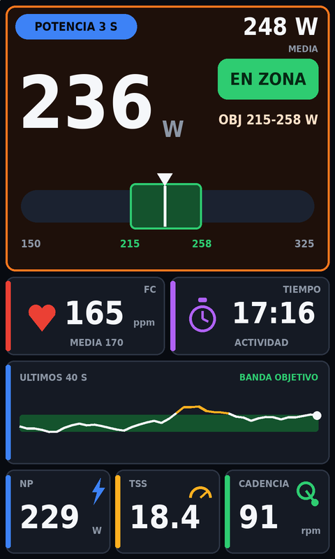

# Zona Potencia 3s (Edge 1050 y 1060)

Campo de datos Connect IQ para Garmin Edge 1050 (y 1060): potencia de 3 segundos a lo grande, con barra dinámica de zona objetivo, gráfico de los últimos 40 segundos, FC, tiempo, media, NP, TSS y cadencia.



Diseño por defecto: tarjetas con barras de color (estilo Edge pro). Si algo no se ve bien en tu Edge, hay un diseño simple de respaldo (`releases/edge-power-zone-edge1050-simple.prg`, maqueta antigua en `docs/maqueta.png`).

## Qué muestra

- **FC** y **tiempo** de actividad (fila superior).
- **POT 3S**: media de potencia de los últimos 3 segundos, en grande. La aguja de la barra, la pastilla de estado y el gráfico usan esta misma media de 3 s (no la potencia instantánea).
- **MEDIA**: potencia media de la actividad.
- **OBJ**: rango objetivo en vatios (se fija en los ajustes, ver abajo).
- **Pastilla de estado**: EN ZONA (verde) / POR DEBAJO -X W (ámbar) / POR ENCIMA +X W (rojo).
- **Barra de potencia con zoom dinámico**: la escala se centra en el objetivo de modo que la zona ocupa ~45% de la barra; los extremos se redondean a 5 W y la escala se ensancha si la potencia sale del rango. Aguja blanca dentro de la zona, ámbar por debajo, roja por encima.
- **ÚLTIMOS 40 S**: gráfico de línea de la potencia 3 s con la banda del objetivo; el tramo que supera el objetivo se pinta en ámbar.
- **NP**: potencia normalizada calculada en vivo (media móvil de 30 s, media de la cuarta potencia).
- **TSS**: estimado en vivo a partir de la NP y el FTP configurado (430 W por defecto). Es una estimación: el Edge calcula su propio TSS al guardar la actividad y puede diferir.
- **CADENCIA**.

## De dónde sale el objetivo

1. **Paso de entrenamiento activo** (TrainingPeaks > Garmin): el campo lee el rango de potencia del paso actual con `Activity.getCurrentWorkoutStep()` (Connect IQ API 3.2.0, soportado en Edge 1050/1060). Valores en vatios o en % de FTP (<150 se interpreta como % y se convierte con tu FTP). En pantalla sale "PASO 215-258 W". Si el paso no tiene objetivo de potencia, no se dibuja zona.
2. **Sin entrenamiento cargado**: objetivo manual (por defecto 215-258 W, FTP 430 W).

Nota: la documentación de Garmin dice que esa llamada lanza excepción en campos de datos, pero es una errata reconocida en el foro de desarrolladores; en el código va dentro de `try/catch` y, si falla, usa el objetivo manual. **Sin probar aún en el Edge real.**

### La barra

- La zona objetivo va siempre centrada, con el mismo margen en vatios a cada lado. Las etiquetas de los extremos son "-X W" y "+X W" respecto al rango.
- Arriba a la derecha: MEDIA LAP (media del lap actual, acumulada en el campo y reiniciada en cada lap/paso), con el mismo color de semáforo.
- Semáforo con la potencia de 3 s: verde dentro del rango, ámbar hasta 10 W fuera, rojo a más de 10 W fuera (aguja y pastilla).

### Cambiar el objetivo manual y el FTP

Los ajustes de Garmin Connect / Connect IQ en el móvil **no se aplican a apps instaladas a mano** (FAQ oficial de Garmin). Por eso los ajustes están en el propio Edge: mantén pulsado el campo > engranaje > Connect IQ > Zona Potencia 3s. Ahí:

- Objetivo mínimo / máximo y FTP: +10, +5, -5, -10 W (se guarda en el Edge).
- Preset por % de FTP: Z2, tempo, sweet spot, umbral, VO2.
- Restablecer: 215-258 W, FTP 430 W.

Alternativas si el menú no aparece en tu firmware: compilar con otros valores por defecto, o copiar un archivo `.SET` con el mismo nombre que el `.prg` a `GARMIN/Apps/SETTINGS`.

## Instalación rápida (2 minutos, sin compilar)

1. Elige tu archivo en la carpeta [`releases/`](releases/):
   - **Edge 1050**: `edge-power-zone-edge1050.prg`
   - **Edge 1060**: `edge-power-zone-edge1060.prg`
   - Si algo no se ve bien en tu Edge, prueba el diseño simple: el mismo nombre acabado en `-simple.prg`.
2. Descárgalo desde GitHub (abre el archivo y pulsa el icono de descarga, o "Download raw file").
3. Conecta el Edge al ordenador por USB y copia el `.prg` a la carpeta `GARMIN/Apps` del Edge.
4. Expulsa el Edge con seguridad y desconecta el cable. Espera a que reinicie.
5. En el Edge: Menú → Perfiles de actividad → tu perfil de bici → Pantallas de datos → añade una pantalla nueva de **1 campo** → pulsa el campo → **Connect IQ** → **Zona Potencia 3s**.
6. Pon tu FTP en el menú del campo (ver "Cambiar el objetivo manual y el FTP"); con un entrenamiento cargado el objetivo sale solo del paso.

Edge 1050 y 1060 tienen la misma pantalla (480x800, API 6.0). Está pensado para una pantalla de un solo campo. Uso bajo tu responsabilidad; proyecto personal, sin relación con Garmin.

## Compilar desde cero

Necesitas: Java, el **Connect IQ SDK 9.3.0 o superior** con el dispositivo **Edge 1050** (y/o 1060) descargado, y una clave de desarrollador.

### 1. SDK Manager

1. Descarga el Connect IQ SDK Manager: https://developer.garmin.com/connect-iq/sdk/
2. Ábrelo e inicia sesión con tu cuenta Garmin.
3. Instala el SDK más reciente y descarga el dispositivo **Edge 1050** (pestaña Devices).

(Opcional: VS Code con la extensión "Monkey C" de Garmin; permite compilar con Ctrl/Cmd+Shift+B. No hace falta para compilar por terminal.)

### 2. Clave de desarrollador (una sola vez)

```bash
openssl genrsa -traditional -out developer_key.pem 4096
openssl pkcs8 -topk8 -inform PEM -outform DER -in developer_key.pem -out developer_key.der -nocrypt
```

Guarda `developer_key.der`: firmar con otra clave crea una app distinta y el Edge la tratará como nueva. La clave no se sube a este repo (está en `.gitignore`).

### 3. Compilar

```bash
export SDK=~/.Garmin/ConnectIQ/Sdks/connectiq-sdk-lin-9.3.0-<id>   # tu ruta del SDK
$SDK/bin/monkeyc -f monkey.jungle -d edge1050 -y developer_key.der -o releases/edge-power-zone-edge1050.prg -w
```

En macOS/Windows el SDK vive en `~/Library/Application Support/Garmin/ConnectIQ/Sdks/...` (macOS) o `%APPDATA%\Garmin\ConnectIQ\Sdks\...` (Windows), y `monkeyc` está en la carpeta `bin` del SDK.

### 4. Simulador (opcional)

```bash
$SDK/bin/connectiq &          # abre el simulador
$SDK/bin/monkeydo releases/edge-power-zone-edge1050.prg edge1050
```

En el simulador: menú **Simulation → FIT Data** o los valores simulados para alimentar potencia/FC/cadencia.

## Estructura

```
manifest.xml                  # app tipo datafield, edge1050 y edge1060, minApiLevel 3.4.0
monkey.jungle
source/PowerZoneApp.mc        # entrada de la app
source/PowerZoneView.mc       # toda la lógica y el dibujo
resources/                    # textos (español), ajustes (objetivo/FTP), icono
releases/edge-power-zone-edge1050.prg  # diseño tiles, Edge 1050
releases/edge-power-zone-edge1050-simple.prg  # diseño simple anterior (respaldo)
releases/edge-power-zone-edge1060-simple.prg  # idem, Edge 1060
releases/edge-power-zone-edge1060.prg  # diseño tiles, Edge 1060
```

