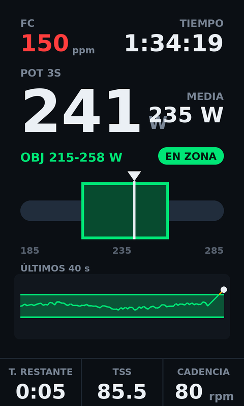

# Zona Potencia 3s (Edge 1060)

Campo de datos Connect IQ para Garmin Edge 1060: potencia de 3 segundos a lo grande, con barra dinámica de zona objetivo, gráfico de los últimos 40 segundos, FC, tiempo, media, NP, TSS y cadencia.



## Qué muestra

- **FC** y **tiempo** de actividad (fila superior).
- **POT 3S**: media de potencia de los últimos 3 segundos, en grande. La aguja de la barra, la pastilla de estado y el gráfico usan esta misma media de 3 s (no la potencia instantánea).
- **MEDIA**: potencia media de la actividad.
- **OBJ**: rango objetivo en vatios (se fija en los ajustes, ver abajo).
- **Pastilla de estado**: EN ZONA (verde) / POR DEBAJO -X W (ámbar) / POR ENCIMA +X W (rojo).
- **Barra de potencia con zoom dinámico**: la escala se centra en el objetivo de modo que la zona ocupa ~45% de la barra; los extremos se redondean a 5 W y la escala se ensancha si la potencia sale del rango. Aguja blanca dentro de la zona, ámbar por debajo, roja por encima.
- **ÚLTIMOS 40 S**: gráfico de línea de la potencia 3 s con la banda del objetivo; el tramo que supera el objetivo se pinta en ámbar.
- **NP**: potencia normalizada calculada en vivo (media móvil de 30 s, media de la cuarta potencia).
- **TSS**: estimado en vivo a partir de la NP y el FTP configurado (430 W por defecto). Es una estimación: el Edge calcula su propio TSS al guardar la actividad y puede diferir.
- **CADENCIA**.

## Importante: el objetivo es manual

Garmin no permite a un campo de datos leer el paso de entrenamiento activo (`Activity.getCurrentWorkoutStep()` está prohibido en campos de datos y lanza una excepción; `Activity.Info` tampoco expone el objetivo del paso). Por eso el rango objetivo se introduce en los **ajustes del campo** (objetivo mínimo y máximo en W). Por eso también el "T. RESTANTE" del paso no existe: en su lugar la fila inferior muestra NP, TSS y cadencia.

Cambiar los ajustes (incluso en plena salida, desde el móvil):

- **Garmin Connect (móvil)**: Más → Dispositivos Garmin → Edge 1060 → Gestión de aplicaciones Connect IQ → Zona Potencia 3s → Ajustes.
- Valores por defecto: objetivo 215-258 W, FTP 430 W.
- Para desactivar la zona: pon el objetivo mínimo a 0 (la barra pasa a escala automática y la pastilla muestra SIN OBJETIVO).

## Instalación (sin compilar)

1. Copia `releases/edge-power-zone.prg` al Edge 1060 por USB, en la carpeta `GARMIN/Apps`.
2. Expulsa el Edge con seguridad.
3. En el Edge: Menú → Perfiles de actividad → (tu perfil de bici) → Pantallas de datos → añade una pantalla nueva de **1 campo** → entra en el campo → **Connect IQ** → **Zona Potencia 3s**.

Está diseñado para una pantalla de un solo campo (480x800). En pantallas con más campos se reescala, pero la distribución está pensada para pantalla completa.

## Compilar desde cero

Necesitas: Java, el **Connect IQ SDK 9.3.0 o superior** con el dispositivo **Edge 1060** descargado, y una clave de desarrollador.

### 1. SDK Manager

1. Descarga el Connect IQ SDK Manager: https://developer.garmin.com/connect-iq/sdk/
2. Ábrelo e inicia sesión con tu cuenta Garmin.
3. Instala el SDK más reciente y descarga el dispositivo **Edge 1060** (pestaña Devices).

(Opcional: VS Code con la extensión "Monkey C" de Garmin; permite compilar con Ctrl/Cmd+Shift+B. No hace falta para compilar por terminal.)

### 2. Clave de desarrollador (una sola vez)

```bash
openssl genrsa -traditional -out developer_key.pem 4096
openssl pkcs8 -topk8 -inform PEM -outform DER -in developer_key.pem -out developer_key.der -nocrypt
```

Guarda `developer_key.der`: firmar con otra clave crea una app distinta y el Edge la tratará como nueva. La clave no se sube a este repo (está en `.gitignore`).

### 3. Compilar

```bash
export SDK=~/.Garmin/ConnectIQ/Sdks/connectiq-sdk-lin-9.3.0-<id>   # tu ruta del SDK
$SDK/bin/monkeyc -f monkey.jungle -d edge1060 -y developer_key.der -o releases/edge-power-zone.prg -w
```

En macOS/Windows el SDK vive en `~/Library/Application Support/Garmin/ConnectIQ/Sdks/...` (macOS) o `%APPDATA%\Garmin\ConnectIQ\Sdks\...` (Windows), y `monkeyc` está en la carpeta `bin` del SDK.

### 4. Simulador (opcional)

```bash
$SDK/bin/connectiq &          # abre el simulador
$SDK/bin/monkeydo releases/edge-power-zone.prg edge1060
```

En el simulador: menú **Simulation → FIT Data** o los valores simulados para alimentar potencia/FC/cadencia.

## Estructura

```
manifest.xml                  # app tipo datafield, solo edge1060, minApiLevel 3.4.0
monkey.jungle
source/PowerZoneApp.mc        # entrada de la app
source/PowerZoneView.mc       # toda la lógica y el dibujo
resources/                    # textos (español), ajustes (objetivo/FTP), icono
releases/edge-power-zone.prg  # compilado listo para GARMIN/Apps
```
